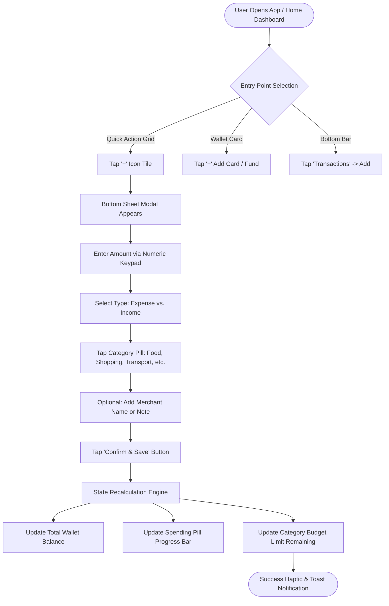
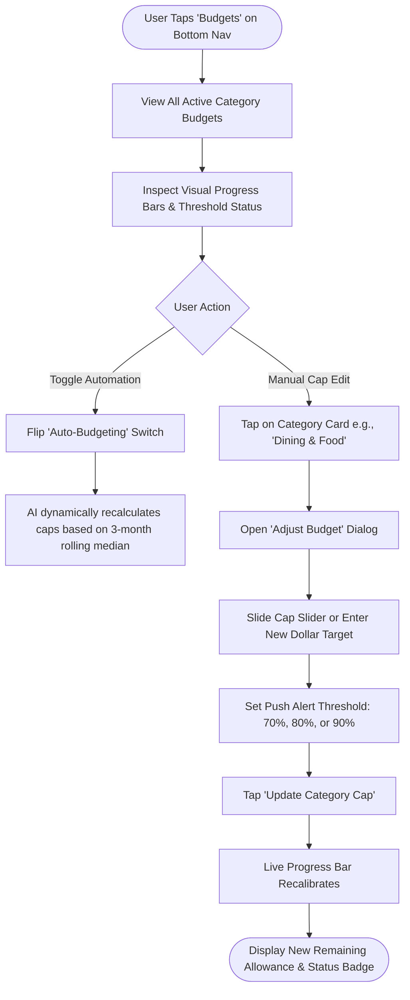
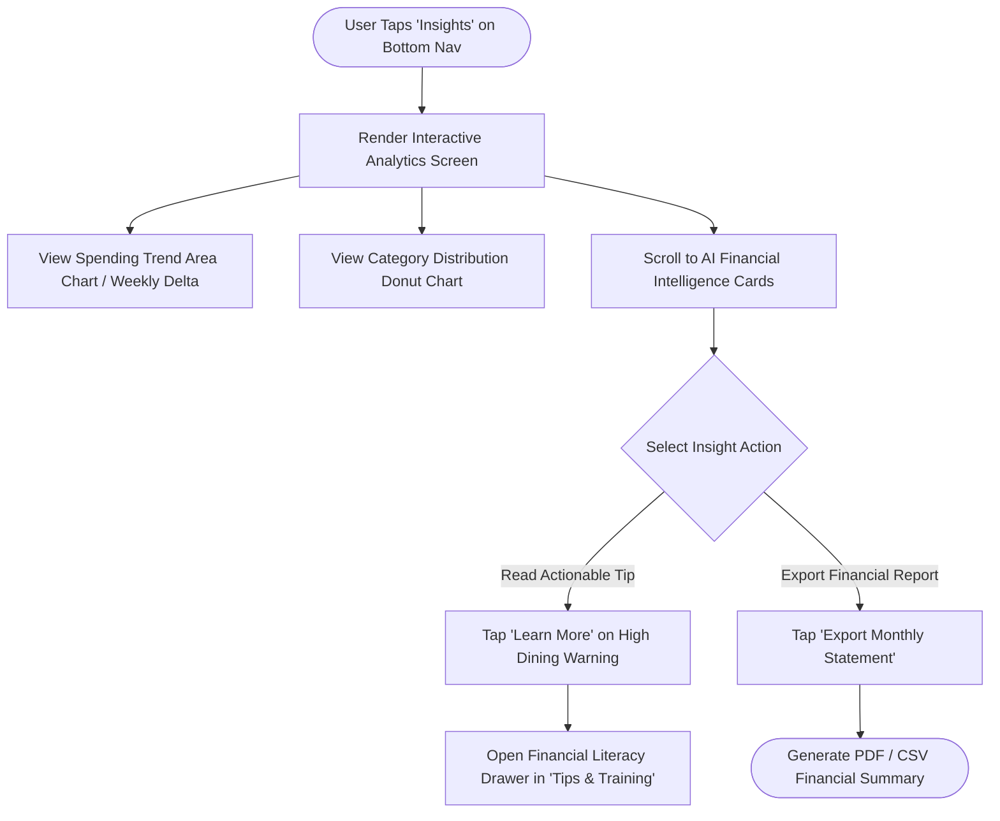

# Corizo UI/UX Design Course — Final Project
# Deliverable 4: Information Architecture & Core User Flows — “MyBudget”

## Executive Summary
This document establishes the structural backbone and behavioral interaction architecture for the **MyBudget** mobile finance app. By structuring content around user mental models rather than database schemas, MyBudget minimizes navigational depth, keeping core workflows within 1–2 taps of the central Home dashboard.

---

## 1. Information Architecture (IA) Site Map

```
                                 ┌─────────────────────────┐
                                 │     MyBudget App        │
                                 └────────────┬────────────┘
                                              │
        ┌───────────────────┬─────────────────┼─────────────────┬───────────────────┐
        │                   │                 │                 │                   │
┌───────▼───────┐   ┌───────▼───────┐ ┌───────▼───────┐ ┌───────▼───────┐   ┌───────▼───────┐
│   Dashboard   │   │    Budgets    │ │ Transactions  │ │   Insights    │   │     More      │
│    (Home)     │   │   (Payment)   │ │  (Activity)   │ │  (Analytics)  │   │  (Services)   │
└───────┬───────┘   └───────┬───────┘ └───────┬───────┘ └───────┬───────┘   └───────┬───────┘
        │                   │                 │                 │                   │
        ├─ Wallet Card      ├─ Category Caps  ├─ Search Bar     ├─ Spending Trend   ├─ Profile Info
        │  (Balance, Card)  ├─ Progress Bars  ├─ Filter Tabs    │  (Area Graph)     ├─ Linked Cards
        ├─ Spending Pills   ├─ Alert Threshold│  (All, In, Out) ├─ Category Donut   ├─ Security
        ├─ Cash Back Hub    ├─ Auto-Budget    ├─ Date Grouping  ├─ Cash Flow        ├─ AI Heatmap
        ├─ Quick Actions    │  Toggle Switch  └─ Transaction    │  (In vs Out)      │  Inspection
        │  (QR, +, Tips)    └─ Adjust Modal      Detail Modal   └─ AI Smart Tips    └─ Logout
        └─ Refer & Earn
```

---

## 2. Core User Flows (Mermaid Flowcharts)

### User Flow 1: Adding a New Expense Transaction (Primary Interaction)
This flow represents the highest-frequency task in the app, optimized for completion in under 4 seconds.



---

### User Flow 2: Setting and Adjusting a Monthly Budget
Ensures users can effortlessly establish financial guardrails and toggle automated budgeting rules.



---

### User Flow 3: Reviewing Spending Insights & AI Recommendations
Guides the user through macro-financial trends, category distribution, and actionable money-saving micro-lessons.



---

## 3. Wireframing Strategy: Mid-Fidelity vs. High-Fidelity

### Mid-Fidelity Wireframes (Structural & Ergonomic Focus)
- **Grid Layout**: 8pt soft grid layout tailored for standard mobile screen widths (375px – 430px).
- **Z-Pattern & F-Pattern Scanning**:
  - Primary focal anchor at top: Profile, Search, and Quick Indicators.
  - Secondary focal anchor: Elevated Wallet card with large typographic balance (`$15,630.71`).
  - Tertiary anchor: 2-column comparison cards (Spending vs Cash Back).
  - Quadrant grid for one-thumb action triggers.
- **Ergonomics**: Bottom navigation bar positioned precisely within the natural thumb sweep zone (bottom 25% of the mobile viewport).

### High-Fidelity UI Implementation
- **Theme**: Deep space dark aesthetic (`#0c0c0e` base, `#18181b` card elevation, `#27272a` borders).
- **Color Accents**:
  - Purple (`#8b5cf6`): Primary brand identity, balance emphasis.
  - Coral Pink (`#f43f5e`): Dining & impulse alerts.
  - Emerald Green (`#10b981`): Income, positive savings, cashback.
  - Amber Yellow (`#f59e0b`): Warning thresholds, utilities.
  - Electric Blue (`#3b82f6`): Investments, tech subscriptions.
- **Micro-Interactions**: Smooth card scale transitions, spring-loaded modal sliding, active tab glowing pill indicators.
